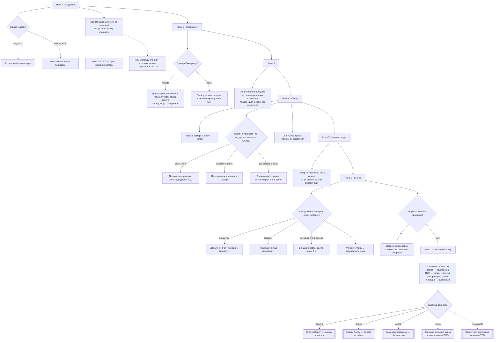
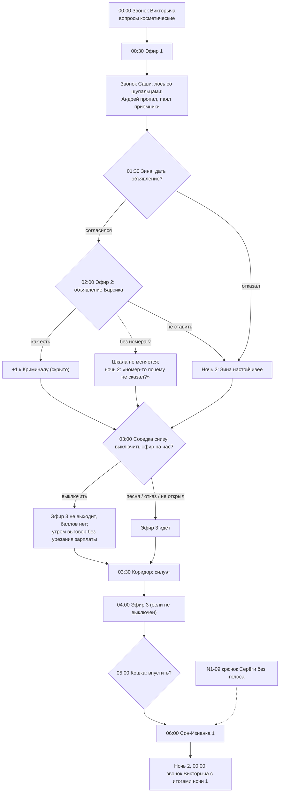
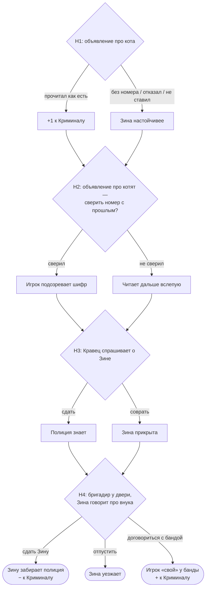
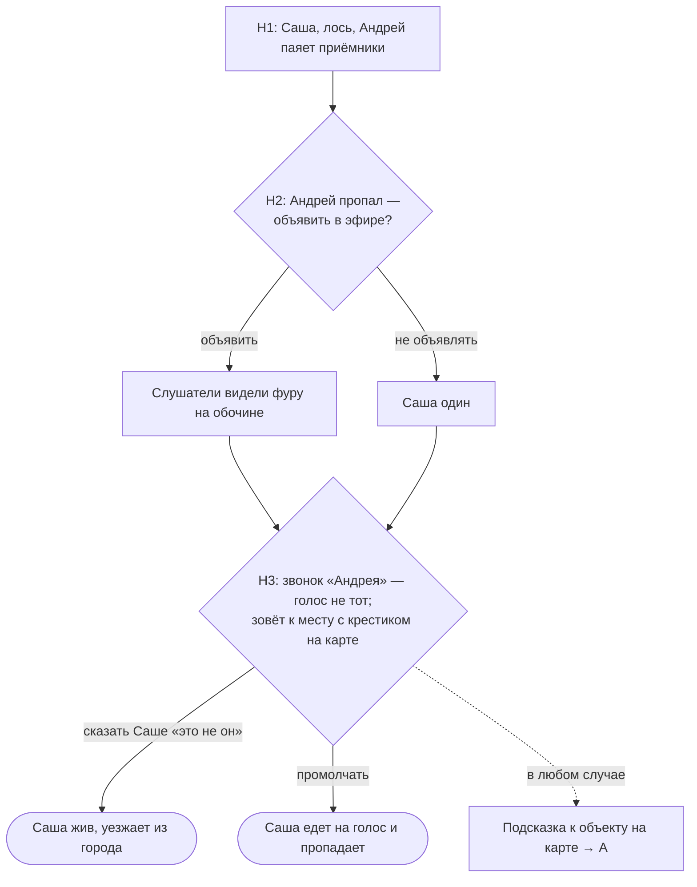
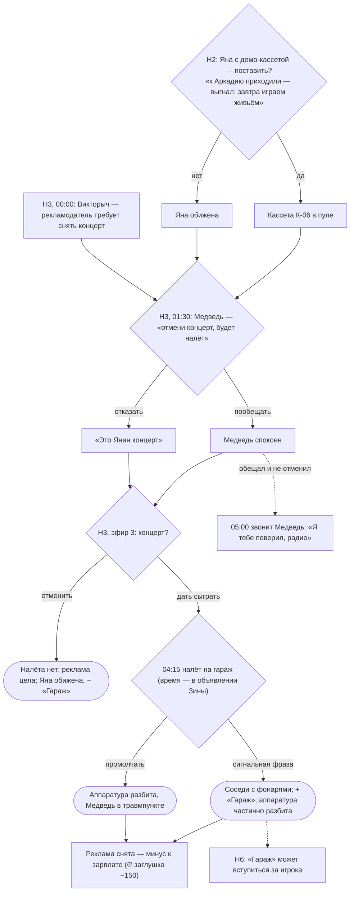
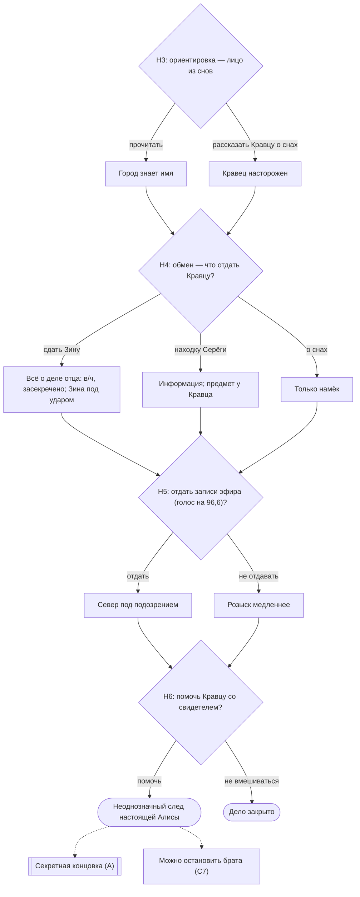
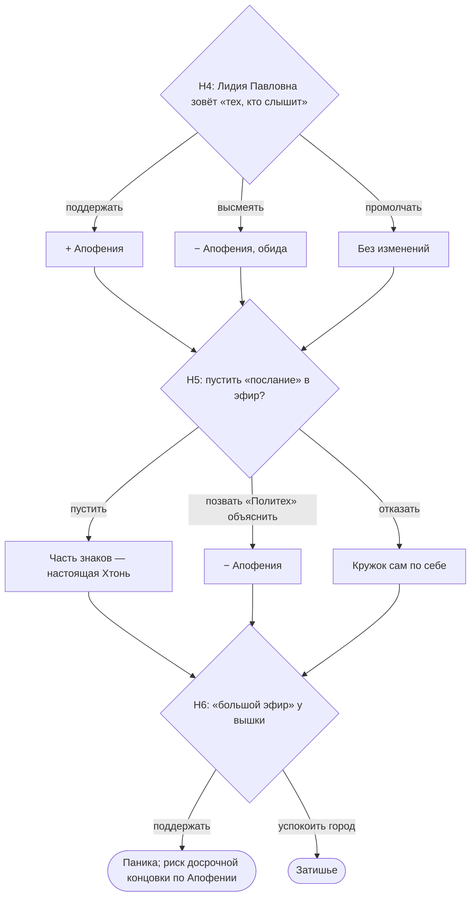
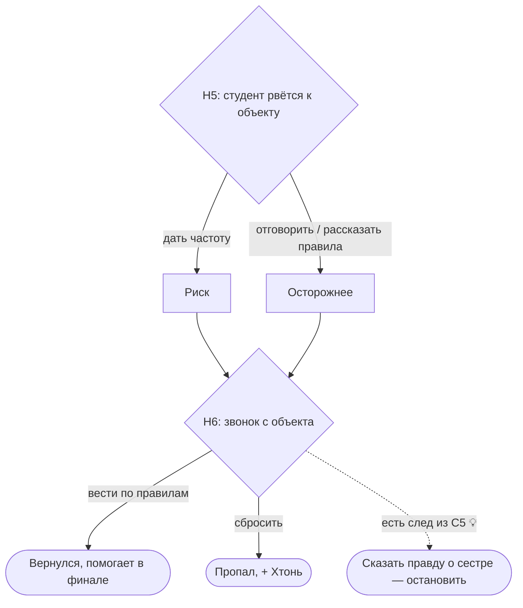
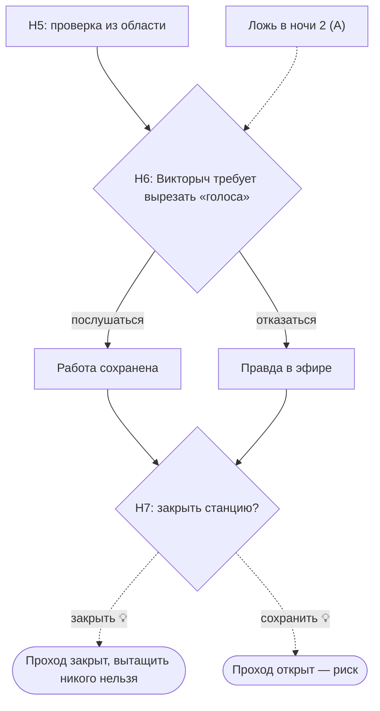
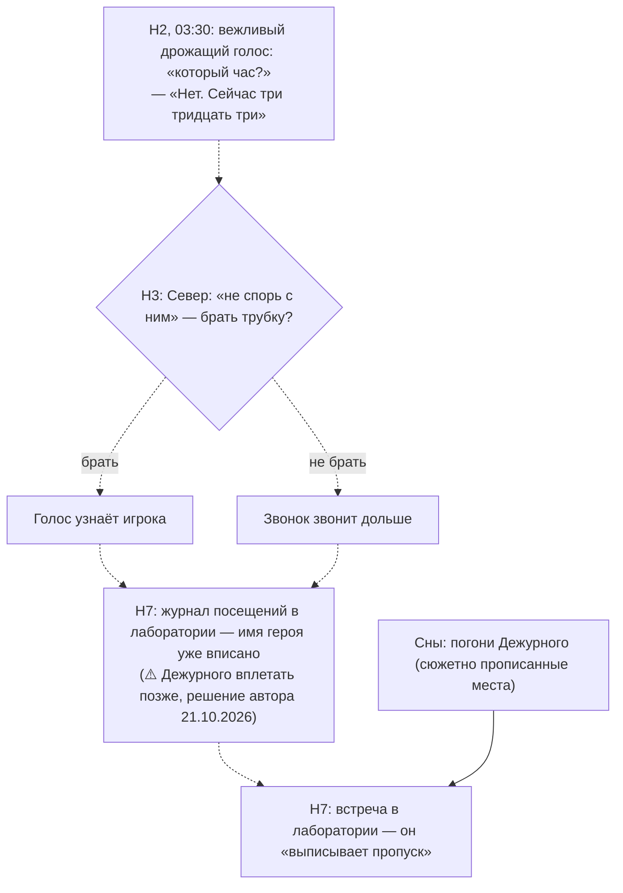

# Скелет семи ночей

> 🟡 Черновик, предложение Claude (17.10.2026). Краткая выжимка — `GDD.md`, раздел 03.1. Сценарии ночей — `Docs/Расписание.xlsx`. Реализованные ночи демо **не учитываются**: все ночи переписываются под целостный сюжет нового билда (решение автора).

## Принцип

Ночь — законченный эпизод, как серия ситкома (20–30 минут, 2–4 эфира). **Всё расписано по кругу Дэна Хармона** — восемь шагов (ниже).

## Круг Хармона подробно

Круг делится пополам: **верх — привычный мир** (порядок, известное), **низ — незнакомый мир** (хаос, неизвестное). Шаги 1–4 — спуск в незнакомое, 5 — самая глубокая точка, 5–8 — подъём обратно. Шаги стоят парами напротив друг друга, и пары полезно проверять вместе: **1↔5** (норма — правда), **2↔6** (чего хотел — чем заплатил), **3↔7** (как ушёл — как вернулся), **4↔8** (что искал — кем стал).

| № | Шаг (у Хармона) | Что значит | Что это в нашей ночи | Вопрос для проверки | Частая ошибка |
|---|---|---|---|---|---|
| 1 | **Зона комфорта** (You) | Кто герой и какой мир сейчас; что считается нормой; тон истории; то, что потом будет под угрозой | Начало ночи, быт квартиры, рутина эфира. Для мини-сюжета — каким мы видим персонажа до событий | Что здесь «нормально» и что станет потерей? | Начать сразу со странного — нет контраста, синусоида не работает |
| 2 | **Желание** (Need) | Чего-то не хватает или что-то не так. Внешняя цель (чего хочет) может не совпадать со скрытой потребностью (что на самом деле нужно). Это двигатель истории | Просьба персонажа, задача ночи, крючок | Чего персонаж хочет и чего ему на самом деле не хватает? | Желание без ставок: если не получит — ничего не теряет |
| 3 | **Вход в незнакомое** (Go) | Порог: ситуация, где старые правила не работают; решение или событие, после которого «как было» уже не будет | Стук в дверь, звонок, аномалия, просьба, которую нельзя проигнорировать | Что именно не даёт вернуться назад? | Порог можно проигнорировать без цены |
| 4 | **Поиск** (Search) | Приспособление: пробы и ошибки, испытания, союзники и противники; герой меняет методы | Механики: эфир, разговоры, правила; **выбор игрока** | Какие у игрока варианты и чем плох каждый? | Один очевидно правильный вариант |
| 5 | **Находка** (Find) | Получить то, чего хотел, — часто не то, чего ждал. Самая глубокая точка: встреча с главным, правда, поворот | Улика, откровение, поворот истории, результат | Что игрок узнаёт такого, что меняет взгляд на историю? | Находка только подтверждает ожидания — поворота нет |
| 6 | **Цена** (Take) | За находку платят: потеря, жертва. У Хармона «take» — ещё и «взять на себя»: принять ответственность, решиться | Шкалы, рассудок, судьбы людей, моральный выбор | Что игрок теряет и больно ли ему? | Цена на бумаге (−1 к шкале), которую игрок не чувствует |
| 7 | **Возвращение** (Return) | Возврат в привычный мир с добытым; последствия догоняют; знание переносится обратно | Утро, конец эфира, звонок Викторыча, сон, итоги | Как привычный мир встречает героя теперь? | Возвращение «как будто ничего не было» |
| 8 | **Изменение** (Change) | Герой и/или мир изменились. Новая норма становится зоной комфорта следующего круга | Состояние на начало следующей ночи: отношения, флаги, что игрок теперь знает | Что игрок теперь думает или может иначе? | Изменения нет — круг не замкнулся |

**Круг всей игры.** Семь ночей тоже складываются в один большой круг: ночь 1 — зона комфорта, 2 — желание, 3 — вход в незнакомое, 4 — поиск, 5 — находка (середина игры: контакт с Серёгой), 6 — цена, 7 — возвращение и изменение (финал и эпилоги). Основной сюжет (A) ниже этому уже соответствует.

## Как оцениваю истории

1. **Ставки.** Игроку не всё равно, чем кончится.
2. **Непростой выбор.** Каждый вариант чем-то платит; «правильного» ответа нет или он неочевиден.
3. **Информация как ресурс** (пиллар GDD 00.3): что игрок узнал и что он с этим сделает.
4. **Связь.** История готовит или окупает что-то в основном сюжете или во фракциях.
5. **Поворот на шаге 5.** История не кончается так, как ожидалось.
6. **Тон.** Каждой ночи нужна тёплая или смешная история и тяжёлая — это синусоида напряжения (GDD 01.1а).
7. **Цена производства.** Новые персонажи и ассеты оправданы тем, что история того стоит.

В каждой ночи:

- **A — основной сюжет** (Серёга, Алиса, Изнанка): один круг на ночь.
- **B — эпизодные мини-сюжеты**: начинаются и заканчиваются в этой ночи, один круг, у исхода есть варианты.
- **C — сквозные мини-сюжеты**: по кругу **на каждую ночь подряд**. Сквозной сюжет **не прерывается**: идёт без пропусков до конца, а после конца в следующих ночах его нет — только мелкие последствия и воспоминания.

Плюс в каждой ночи: случайные заявки слушателей (`Broadcast.xlsx`), рандомная Хтонь квартиры (GDD 00.6, 01.9), звонки Викторыча в начале и в конце, ларёк между ночами.

## Карта ночей

| Ночь | Название | Изменение в основном сюжете | Сквозные сюжеты (C) | Эпизодные (B) |
|---|---|---|---|---|
| 1 | Подмена | С Серёгой что-то не так | Шифры Зины | Соседка снизу · Саша и Андрей (закрывается в ночи 1) |
| 2 | Серёги нет | Серёга пропал, а не уехал | Шифры Зины · «Гараж» | Аварийка (Дядя Коля) |
| 3 | 💡 название позже | Алиса из снов — реальная пропавшая девушка, и Серёга с ней связан | Шифры Зины · «Гараж» (концерт) · Розыск Алисы | Конспиролог (окно случайной встречи, пока статично) |
| 4 | Склад | Цель — вытащить | Шифры Зины (бригадир, «долг Серёги») · Розыск Алисы · Кружок | Уфолог |
| 5 | Цена прохода | Появляется дилемма | Розыск Алисы · Кружок · Студент · Станция | «Джинса» Вовы · Жена «не того» мужа · Сосед с ключами |
| 6 | Выбор | Игрок выбирает сторону | Розыск Алисы · Кружок · Студент · Станция | Чёрная рука |
| 7 | Последний эфир | Финалы и эпилоги | Станция | Прощальные звонки |

## Дерево выборов

> 19.10.2026. Схемы Mermaid — в Obsidian отображаются как диаграммы. **Как читать:** ромб — выбор игрока; прямоугольник — событие или последствие; скруглённый — исход сюжета; двойная рамка — концовка. **Сплошная стрелка** — решено автором или уже собрано; **пунктирная** — предложение Claude (💡) или не решено. Номера сцен — по `Расписание.xlsx`.

### Основной сюжет (A) по ночам

### Ночь 1 подробно (как собрана, 18.10.2026)

### Сквозные сюжеты (C)

#### C1. Шифры Зины — ночи 1–4

#### C3. Саша и Андрей — ~~ночи 1–3~~ → закрывается в ночи 1 (19.10.2026); схема ниже — прежний вариант

#### C4. «Гараж» — знакомство (ночь 2), «Концерт в эфире» (ночь 3)

#### C5. Розыск Алисы — ночи 3–6

#### C6. Кружок Лидии Павловны — ночи 4–6

#### C7. Студент-радиолюбитель — ночи 5–6 (💡 брат настоящей Алисы — не решено)

#### C8. Станция под угрозой — ночи 5–7 (💡 передатчик держит проход — не решено)

#### C9. Дежурный — направление принято, по ночам — дописать (21.10.2026)

> Точного 3:33 на часах нет: часы идут шагами по полчаса. 💡 Поэтому звонок приходит на обычной отметке (например, 03:30), а «3:33» — **его** время, время аварии на объекте.

## Сводка разбора (предложения, не применены)

Подробности — у каждой истории ниже, в блоке «Разбор». Таблицы ниже пока не менялись: правки вносятся после решения автора.

| История | Вердикт | Коротко |
|---|---|---|
| A. Основной сюжет | **Усилить** | Крючок в конце ночи 1, лицо у противника, выбор в ночи 2 |
| B1. Соседка снизу | Усилить | Дать цену: тишина стоит баллов эфира |
| B2. Конспиролог | **Объединить** с C6 | Дублирует кружок апофении |
| B3. Дядя Коля | **Объединить** с B9 | Обе истории про вещь Серёги у соседа |
| B4. Пиковая дама | Усилить | Зеркало показывает ночь исчезновения: улика против рассудка |
| B5. Пара за стеной | **Усилить** | Проводы на войну — сильная моральная история |
| B6. «Джинса» Вовы | Усилить | Вова сам жертва банды |
| B7. Уфолог | **Удалить** | Только носитель улики; улику отдать другому |
| B8. Жена «не того» мужа | Оставить | Сильная; добавить неопределённость |
| B9. Сосед с ключами | Объединить с B3 | См. B3 |
| B10. Чёрная рука | Усилить | Ребёнок один дома: рейтинг против ребёнка |
| B11. Прощальные звонки | **Удалить** как B | Это финал ночи 7, часть A |
| C1. Шифры Зины | Усилить | Дать Зине человеческую причину |
| C2. Кошка | **Удалить** как C | Перенести в A и в механику |
| C3. Саша и Андрей | Усилить | Голос «Андрея» зовёт к объекту |
| C4. «Гараж» | Усилить | ✅ Короткие истории: знакомство (н2), «Дань» (н3), «Концерт в эфире» (н4) |
| C5. Розыск Алисы | Оставить | Осторожно с ранним раскрытием |
| C6. Кружок Лидии Павловны | **Усилить** | Вера из горя, а не из глупости |
| C7. Студент-радиолюбитель | **Усилить** | Он брат настоящей Алисы |
| C8. Станция под угрозой | **Переделать** | Передатчик станции держит проход открытым |
| **Новое:** C9. Звонок в 3:33 | Добавить | Тишина в трубке каждую ночь → голос Серёги |
| **Новое:** B. Пиратская кассета | Добавить | Сильная кассета ценой денег для банды |
| **Новое:** B. Пятый дозвонившийся | Добавить | Честно по правилам или по-доброму |
| **Новое:** B. Нужна кровь | Добавить | Срочное объявление против оплаченной рекламы |
| **Новое:** B. Человек на мосту | Добавить, осторожно | Самый тяжёлый звонок ночного эфира |

---

## A. Основной сюжет

| Ночь | 1. Зона комфорта | 2. Желание | 3. Вход в незнакомое | 4. Поиск | 5. Находка | 6. Цена | 7. Возвращение | 8. Изменение |
|---|---|---|---|---|---|---|---|---|
| **1. Подмена** | Обычный парень соглашается на неделю подменить друга | Отработать первую ночь без косяков | Квартира-студия: Серёги нет, вещи на месте | Осваивает эфир, звонки, гостей | Карта с крестиками; первый голос в помехах | Первая странность в квартире | Первый Сон-Изнанка: погоня за девушкой по парку (GDD 02.21б); утро, звонок Викторыча, зарплата | «С Серёгой что-то не так» |
| **2. Серёги нет** | Уже знает пульт | Понять, где Серёга, и прикрыть его перед начальником | Викторыч давит; впервые звонит Север | Вещи Серёги, свидетели | Серёга что-то искал вместе с Севером; первая точка на карте вычеркнута | Ложь начальнику | Сон с Алисой | Серёга пропал, а не уехал |
| **3. 💡 Название позже** | Привык к ночной работе | Понять, что творится | Ориентировка Кравца: на фото — девушка из снов | Кравец: Серёга — свидетель по делу пропавшей Алисы | Алиса — реальный человек, и Серёга был с ней связан | Тревога: кому верить — снам или ориентировке | Сон | Алиса из снов — реальная пропавшая |
| **4. Склад** | Знает правила | Найти, где Серёга | Карта и замеры Серёги сходятся в одну точку | Свидетели; обмен с Кравцом (дело отца Алисы, «в/ч») | Точка — заброшенный военный склад | Знание стоит: Зина, улика или доверие | Алиса впервые просит помочь ей выбраться | Цель — вытащить |
| **5. Цена прохода** | Знает, где искать | Понять, как вытащить | Север показывает чертежи отца Алисы | Разбирает их с Севером | 💡 Правило прохода: за одно открытие выходит один | Вытащить можно не всех | Алиса и Серёга — по разные стороны | Появляется дилемма |
| **6. Выбор** | Знает почти всё | Подготовить выход | Давят все сразу: город, фракции, Хтонь | Поездка на склад (мини-локация): аптечки Серёги — кому отдать | Фонарик Алисы у задраенного люка: вход здесь | Досрочные концовки у тех, кто перебрал | Ночь перед последним эфиром | Игрок выбирает сторону |
| **7. Последний эфир** | Последняя смена | Вытащить того, кого выбрал | Установка с Севером (лампа); склад → спуск в лабораторию (мини-локация) | Лаборатория: Отпечатки, журнал, Дежурный | Правда об Алисе | Дилемма вагонетки (GDD 01.7) | Утро | Финалы и эпилоги |

**О чём — коротко.** Обычный парень на неделю подменяет друга на ночном радио и обнаруживает, что друг не уехал, а пропал. По вещам, свидетелям и правилам, которым его учит Север, он выходит на заброшенный военный склад, под которым — секретная лаборатория и проход в Изнанку. Там застрял Серёга. А во снах и в помехах всё это время с героем говорит девушка Алиса, и он к ней привязывается. В середине недели он узнаёт, что вытащить можно не всех (сам Серёга до конца с ним не связывается — решение автора 18.10.2026). В последнюю ночь он выбирает, кого спасать, — и узнаёт, что Алиса была существом с той стороны.

**О чём — подробно.**

*Что было до игры.* В 80-х рядом с городом работал научно-военный объект, где экспериментировали с радиоэфиром. Эксперимент открыл проход в иное измерение — Изнанку; разлом возник на месте подземной базы. Проект свернули, входы запечатали наспех. Отец Алисы работал на объекте и в ночь аварии остался там. Годы спустя настоящая Алиса нашла чертежи отца (его не стало в ночь аварии — он среди «Отпечатков», 01.9) и пришла с ними в «Политех» к Северу: где сама лаборатория, она не знала. Север начал искать сигнал объекта и позвал Серёгу. Вдвоём они ходили с приёмниками по городу (водонапорная башня, парк, набережная…) и отмечали на карте, где сигнал сильнее, — как в радиолюбительской «охоте на лис»; зачёркнутые крестики — места, где «глухо». Замеры вывели на заброшенный советский военный склад; лаборатория — под ним. На складе Серёга стал таскать армейские аптечки АИ-2 для бандитов (💡 в них был шприц-тюбик с промедолом — поэтому банде они и нужны). Втроём они исследовали склад. Север осторожничал («подождём, надо проверить приборы»), а Алисе не терпелось узнать, что случилось с отцом: она пошла на склад одна, открыла вход в лабораторию и вышла к разлому. Существо с той стороны увидело её и взяло её облик и поведение; сама Алиса в Изнанку не попала и осталась в нашем мире, но для города она пропала без вести. Серёга с Севером стали её искать. Меньше чем через неделю Серёга нашёл открытый Алисой вход и спустился за ней — он был уверен, что она там. Он не знал, с какой мощностью и в каком радиусе действует проход, и его затянуло в Изнанку; как вернуться, он не знает. Для игрока карта Серёги — головоломка ночей 3–4: по замерам, запискам и свидетелям он сам вычисляет склад, без одной прямой подсказки (решение автора 22.10.2026). Герой ничего этого не знает: для него Серёга просто попросил подменить его на неделю.

*Ночь 1 — Подмена.* Герой приходит в квартиру-студию друга. Серёги нет, но всё выглядит так, будто он вышел на минуту: вещи на месте, на стене карта города с крестиками. Герой осваивает работу — эфир, заявки, звонки, гостей — и первая ночь кажется почти уютной. Но в помехах на мгновение звучит девичий голос, а в квартире случается первая странность, которую легко списать на усталость. Ночью приходит первый **Сон-Изнанка** (GDD 02.21б): чёрная пустота, парк с аттракционами и водоёмом из светящихся точек. Девушка появляется и исчезает, зовя героя за собой, и он бежит за ней от точки к точке: поговорить с ней пока не удаётся, она ускользает. Только в конце сна она говорит одну фразу — намёк, что сделать во вторую ночь (например, поставить в эфире её песню). Утром звонит Викторыч, считает зарплату и спрашивает, не объявлялся ли Серёга. Герой засыпает с мыслью, что с другом что-то не так.

*Ночь 2 — Серёги нет.* Серёга не вернулся. Викторыч давит: где твой друг? Герой решает, прикрыть его или сказать правду. Впервые звонит Север — коротко, сухо, будто проверяет, кто теперь сидит у пульта. Вещи Серёги и рассказы соседей складываются в картину: он что-то искал, и искал не один. Одна из точек на карте оказывается ложной. Ночью приходит второй сон — первый долгий разговор с Алисой на отвлечённые темы (сон во второй ночи будет — решение автора 19.10.2026). А на приёмнике, между станций, можно поймать что-то от неё (💡 звуки парка из первого сна). К утру ясно: Серёга не уехал, он пропал.

*Ночь 3.* (Переписано 26.10.2026: правила Севера — черновик, ниже; место в ночи отдано живым сюжетам.) Кравец присылает ориентировку на пропавшую девушку — на фото лицо из снов героя. Ночью Кравец звонит: Серёгу ищут как свидетеля по делу Алисы — мать девушки рассказала, что дочь ходила с «парнем с радио». Алиса из снов оказывается реальным пропавшим человеком, а Серёга — связан с ней. Вокруг — концерт «Гаража» под давлением банды (C4) и первое знакомство с апофениками (конспиролог).

> **Черновик — правила Севера** (автор 26.10.2026: пока слабо, оставить в доках). Север учит героя правилам: кому не открывать, на какие звонки не отвечать, что нельзя пускать в эфир; правила проверяются на практике, нарушение бьёт по рассудку. Кандидаты правил: «в полчетвёртого трубку не бери», «голос без имени в эфир не выпускай», «не открывай, если стучат три раза и молчат», «не спорь с ним, если взял».

*Ночь 4 — Склад.* Карта и замеры Серёги, его записки и рассказы свидетелей сходятся в одну точку — заброшенный военный склад за городом. Кравец предлагает обмен: он расскажет, что знает о деле Алисы, если герой даст ему что-то взамен (сдать Зину, отдать находку Серёги или рассказать о снах — полнота информации по цене). Так герой узнаёт, что отец Алисы погиб в 1986-м «при исполнении» на войсковой части, подробности засекречены. Во сне Алиса впервые просит помочь ей выбраться. Цель меняется: не найти друга, а вытащить. (Переписано 22.10.2026: лаборатория — только в ночи 7, склад — в ночах 6–7, решение автора.)

*Ночь 5 — Цена прохода.* Север наконец показывает то, что прятал: копии чертежей отца Алисы. Разбирая их вместе, герой понимает правило прохода: за одно открытие выходит только один (✅ решение автора 22.10.2026). Вытащить можно не всех. Алиса и Серёга оказываются по разные стороны выбора, и от того, как герой вёл себя с Алисой, зависит, доверие это или первые сомнения. Голоса Серёги нет: он присутствует только через вещи и свидетелей (решение автора 18.10.2026).

*Ночь 6 — Выбор.* На героя давят все сразу: город, фракции, Хтонь, которая проявляется всё сильнее. Герой впервые едет на склад (мини-локация) и находит тайник Серёги — ящики армейских аптечек, которые тот не успел передать бандитам. Кому их отдать — развязка оси Криминал ⟷ Полиция перед финалом (💡 отдал бандитам — в ночи 7 они не мешают; сдал Кравцу — склад опечатан; оставил или уничтожил — банда ждёт у склада). У задраенного люка — фонарик Алисы: вход здесь, но пока не открыть. Тот, кто довёл отношения с какой-то стороной до края, получает досрочную концовку прямо здесь.

*Ночь 7 — Последний эфир.* Последняя смена и финальный эфир. С Севером герой собирает установку (лампа из тайника Серёги точно есть в игре, её применение — продумать, решение автора 22.10.2026), едет на склад и спускается в лабораторию (мини-локация): Отпечатки, журнал посещений, Дежурный. Герой делает выбор вагонетки: друг Серёга или Алиса, к которой он успел привязаться (GDD 01.7). Возможен и третий путь — пожертвовать собой и помочь обоим. В конце герой узнаёт, что Алиса — существо, жившее в Изнанке. Испытывала ли она к нему чувства или он был лишь способом выбраться — игра не отвечает, это решает сам игрок. Утро и эпилоги показывают, что стало с героем, с теми, кого он спас или оставил, и с городом по каждой из сторон.

**Разбор.**

- **Работает:** у каждой ночи понятное изменение, а сами ночи складываются в большой круг игры (середина — ночь 5, контакт с Серёгой).
- **Слабо: медленный старт.** ✅ *Принято автором (18.10.2026): первую ночь делать интригующей, расставить в ней крючки будущих сюжетов; во сне отдельно познакомить с Алисой (первый Сон-Изнанка, GDD 02.21б). Конкретные крючки — при написании ночи 1. Кандидаты (💡): сообщение Серёги на автоответчике, записанное уже после его «отъезда» (главный крючок); первый звонок в 3:33 (C9, фоновый); крестик на карте, обведённый свежей ручкой.*
  - **Мистика с первой ночи** (автор, 18.10.2026): с самого начала показать, что игра мистическая, с небольшими хоррорными элементами; крючки — не только про Серёгу, но и про Хтонь. Пример автора: игрок идёт по коридору, свет тускнеет, коридор растягивается, в конце — силуэт; подходишь ближе — глюк развеивается, ты снова в своём коридоре. Должно оставаться место списать на усталость (нарастание, синусоида).
  - ✅ *Решение автора (18.10.2026):* **автоответчик с голосом Серёги — не берём.** История как в первом сезоне «Очень странных дел»: друг пропал в другом мире, долго (возможно, всю игру) с ним нельзя связаться и его нельзя услышать; простая запись голоса крючка не даёт. **Хтонь с коридором — берём** в ночь 1. ✅ *Уточнение (22.10.2026):* Серёга сам связаться не может как минимум до финала; в финале — обсуждаемо, может быть добавим. Ночь 5 переписана («Цена прохода», без голоса). ⚠️ Концовка C9 («звонил Серёга») — пересмотреть вместе с Дежурным.
  - ~~Автоответчик — варианты~~ (отклонено, оставлено для истории). (1) **«Он спокоен»** (рекомендация): одно сообщение, время записи — сегодня, 01:47, хотя телефон при игроке не звонил; будничный голос Серёги («Старик, привет… доехал. Тихо тут. Светло очень. Не жди, я задержусь»), а на фоне еле слышно играет **та же песня, что сейчас в эфире** — Серёга слушает эфир оттуда, где он. (2) **«Повтор»**: сообщение звучит дважды, во второй раз вместо «пока» — тишина и дыхание. (3) **«Обрывок»** про Алису — слишком явно пересекает ветки Серёги и Алисы, не рекомендуется.
  - 💡 *Хтонь первой ночи — кандидаты:* коридор (пример автора); отражение в тёмном экране телевизора двигается с запозданием; огни города за окном гаснут квартал за кварталом и зажигаются обратно; в помехах приёмника один раз звучит имя героя.
  - 💡 *Порядок ударов в ночи 1:* коридор — после первого эфира (контраст с уютом работы); автоответчик — ближе к концу ночи; Сон-Изнанка — финал. Три удара по трём линиям: Хтонь, Серёга, Алиса. До ночи 3 мистика может читаться как случайность, и игрок, привыкший к Static Dread, заскучает. *Предложение:* жёсткий **крючок в конце ночи 1** — например, на автоответчике сообщение Серёги, записанное **сегодня ночью**, уже после его «отъезда». Игрок уходит спать с вопросом, на который хочет ответа.
- **Слабо: выбор в ночи 2 бесплатный.** ✅ *Принято автором с правкой (18.10.2026): развилка нужна, но без увольнения Серёги — увольнять за то, что он пропал, нелогично. Новая цена (✅ принято автором 18.10.2026): правда Викторычу → он звонит в милицию, Кравец приходит раньше и изымает часть вещей Серёги как улики, зато Серёгу ищут официально; ложь → вещи остаются, игрок один, а позже Викторыч узнаёт правду (C8) и перестаёт доверять.* Исходное предложение: «Прикрыть Серёгу перед начальником» — враньё без последствий. *Предложение:* сделать развилку. Соврал Викторычу — Серёгу не уволят, но никто не ищет, и игрок один. Сказал правду — Викторыч звонит в милицию, Кравец появляется раньше, а Серёгу увольняют заочно. Оба пути двигают сюжет, но по-разному.
- **Слабо: у основного сюжета нет лица противника.** ✅ *Облик и подача (21.10.2026): Выглядит как **контролёр или консьерж**, неестественно высокий, с длинными конечностями (как Слендермен); лицо либо не видно, либо застыло в постоянной устрашающей улыбке. Когда он говорит — **дрожащий текст** и нагнетающая музыка на фоне. Иногда появляется **во снах героя** (в сюжетно прописанных местах) и **гонится за игроком**. Вписывается в сюжет постепенно, связывая его с остальными событиями ночей (решение автора 21.10.2026). Нагнать больше мистики и хоррора.* ✅ *Принято автором с правкой (18.10.2026): противник есть, но игрок **не до конца понимает его суть и намерения** — как древние боги у Лавкрафта, которых человек не способен понять: для человека они как стихийное бедствие. Дежурный не объясняет себя и не торгуется; события вокруг него — как погода: их можно пережить, но не победить.* Исходное предложение: Хтонь безмозглая, бандиты — побочная линия. *Предложение:* рано посеять **Дежурного** (древняя Хтонь, GDD 01.9) как вежливый ночной голос, который с ночи 2 изредка звонит в эфир и спрашивает «который час». Игрок не понимает, кто это, а в ночи 6 узнаёт его голос в лаборатории.
- **Вес Серёги** (GDD 01.7: Алиса не должна выигрывать по эмоциям даром). ✅ *Принято автором (18.10.2026).* *Предложение:* с ночи 1 давать его голос в старых эфирах на кассетах — шутки, манера, любимые песни, — чтобы игрок полюбил его до того, как станет выбирать.
- **Алиса.** ✅ *Принято автором (18.10.2026).* Первые три ночи с ней должны быть самыми уютными сценами игры — это контраст. Ей нужны привычки и маленькие недостатки, а подсказки должны работать в обе стороны: что-то говорит «она человек», что-то — «она чужая» (например, никогда не спрашивает ничего о себе, но знает то, что было только в записках Серёги).

---

## B. Эпизодные мини-сюжеты

| Ночь | Сюжет | Ветка | 1. Зона комфорта | 2. Желание | 3. Вход в незнакомое | 4. Поиск | 5. Находка | 6. Цена | 7. Возвращение | 8. Изменение | Исходы |
|---|---|---|---|---|---|---|---|---|---|---|---|
| 1 | **Соседка снизу** | Соседи | Тихий эфир | Соседка хочет тишины | Стук: «вы мне спать не даёте!» | Сделать тише, поговорить, не открывать | Она одинока и не спит из-за мужа в больнице | Тишина в эфире или её обида | Дверь закрыта | Игрок знает соседей | Тише — она спокойна · Песня для неё — тёплое знакомство · Не открыл — жалоба Викторычу |
| 2 | **Конспиролог** | Апофения | Обычные звонки | Пенсионер хочет «предупредить город» | В эфире: «вышки облучают!» | Дать слово, высмеять, оборвать | Он искренне боится | Эфир на стороне веры или здравого смысла | Звонок окончен | Город слышит или не слышит слух | Дать слово — + Апофения · Высмеять — − Апофения, обида · Оборвать — без последствий |
| 2 | **Дядя Коля** | Соседи | Ночь идёт | Сантехник «проверить трубы» | Чужой человек в квартире Серёги | Впустить, расспросить | Видел Серёгу с шипящим радио | Время, пока он возится | Уходит | Первая ниточка к Серёге | Впустил и расспросил — улика · Не впустил — ничего |
| TBD | **Пиковая дама** | Хтонь | Ванная | Игрок хочет умыться | На зеркале нарисована помадой лестница | Посмотреть в зеркало, завесить, позвать Севера | Что-то в зеркале смотрит в ответ (мини-локация) | Рассудок | Свет мигнул, всё прошло | Хтонь бывает внутри квартиры | Посмотрел — мини-локация, − рассудок · Завесил — тихо · Позвал Севера — правило |
| TBD | **Пара за стеной** | Соседи | Тишина за стеной | Соседи мирятся или ругаются | Крик, грохот | Песня для примирения, постучать, сделать громче | Это не ссора, а прощание: он уходит в армию | Неловкость | Стихло | Город живёт своей жизнью | Песня — помирились · Постучал — замолчали · Громче — продолжили |
| 5 | **«Джинса» Вовы** | Криминал | Обычный эфир | Вова хочет скрытую рекламу магазина | Конверт с деньгами | Взять, отказать, рассказать Викторычу | Магазин платит банде | Деньги против честности эфира | Конверт взят или возвращён | Игрок в деле или вне его | Взял — деньги, + к Криминалу · Отказал — Вова обижен · Сдал Викторычу — штраф Вове |
| 4 | **Уфолог** | Апофения | Почта под дверью | Уфолог хочет, чтобы прочли его вырезки | Газета про «аномальную зону» за городом | Прочесть в эфире, выбросить, отдать Северу | Одна вырезка — про аварию на объекте в 80-х | Время эфира | Уфолог благодарит или обижается | Игрок видит, что «аномальщина» иногда правда | В эфир — + Апофения · Выбросить — ничего · Северу — улика для A |
| 5 | **Жена «не того» мужа** | Хтонь | Поздний звонок | Женщина хочет, чтобы её успокоили | Муж вернулся «чуть не таким» | Дать правило, успокоить, положить трубку | Это Хтонь (Повторный гость) | Рассудок; последствия в мире | Звонок оборвался | Хтонь в городе, а не только у игрока | Правило — она закрывает дверь · Успокоил — завтра она не звонит · Положил трубку — тишина |
| 5 | **Сосед с ключами** | Соседи | Тихая ночь | Сосед-выпивоха потерял ключи | Он у двери в три ночи | Пустить переночевать, выставить | Он рассказывает, что Серёга занимал у него паяльник | Он храпит, мешает эфиру | Утром уходит | Мелкая улика и смешной эпизод | Пустил — улика · Выставил — ничего |
| 6 | **Чёрная рука** | Хтонь | Звонки детей | Ребёнок хочет рассказать страшилку | В эфир — «Чёрная рука» | Выпустить в эфир, сбросить | Страшилка «приживается» в городе | Хтонь + последствия в мире | Звонок окончен | Эфир — проводник | Выпустил — + Хтонь, соседи рассказывают «случай» · Сбросил — тихо |
| 7 | **Прощальные звонки** | Слушатели | Последняя смена | Постоянные слушатели хотят попрощаться | Звонки один за другим | Ответить, поставить песни | Итог отношений с городом | Время последнего эфира | Утро | Город запомнил ведущего | Зависит от репутации |

### О чём каждая эпизодная история и разбор

**B1. Соседка снизу (ночь 1).** Посреди эфира стучит пожилая соседка: шум мешает ей спать. Выясняется, что она не спит не из-за радио, а потому что муж в больнице и ей страшно одной.
✅ *Решение автора (18.10.2026): с ценой — тишина стоит баллов эфира. Но ночь 1 обучающая, поэтому начальник даёт выговор, а зарплату в первый раз не урезает.*

*Разбор — усилить.* Хорошо как первое обучение двери, но выбор очевиден: быть добрым ничего не стоит. *Предложение:* она просит **выключить эфир на час** — то есть игрок буквально платит баллами эфира за чужое спокойствие. Тогда это первый маленький выбор «работа или человек», и он задаёт тон всей игре.

✅ *Решение автора (19.10.2026): конспиролог — постоянный случайный слушатель в пуле `Broadcast.xlsx` (несколько заявок), без отдельного сюжета.*

**B2. Конспиролог (ночь 2).** Пенсионер требует объявить в эфире, что городские вышки облучают людей.
*Разбор — объединить с C6.* Сам по себе это одна реплика и выбор «смеяться или нет». Тема апофении целиком живёт в кружке Лидии Павловны (C6) — конспиролог лучше смотрится как один из её людей, а его звонок — как первый шаг кружка.

✅ *Решение автора (19.10.2026): объединить с B9 в «Долг Серёги» (ночь 2).*

✅ *Переделано (решение автора 22.10.2026): ящика с инструментом нет. Коля приходит по **аварийному вызову** — стояк гудит; на трубе провод Серёги (заземление установки на водопровод). Снимая экран под ванной, Коля находит **тайник Серёги**. Деталь Хтони мимоходом: «в подвале трубы поют». Выбор — снять провод (тише, но приёмник ловит хуже) или оставить.*

**B3. Дядя Коля (ночь 2).** Сантехник просится проверить трубы и между делом рассказывает, что видел Серёгу с шипящим радио.
*Разбор — объединить с B9.* Сейчас это раздача улики без выбора. B9 (сосед с ключами) тоже про вещь Серёги у соседа. *Предложение:* одна история **«Долг Серёги»**: дядя Коля приходит за ящиком с инструментами, который Серёга у него «одолжил навсегда». В ящике — деталь с объекта. Отдать — честно, но улика уходит из рук. Оставить себе — соврать соседу, который помогает и рассказывает о Серёге. Есть выбор и есть цена.

**B4. Пиковая дама (~~ночь 3~~ → ночь TBD, решение автора 26.10.2026: убрана из ночи 3).** На зеркале в ванной кто-то нарисовал помадой лестницу. Если посмотреть в зеркало, оно смотрит в ответ.
*Разбор — усилить.* Хороший хоррорный момент, но цена только в рассудке, а награды нет — игрок просто не будет смотреть. *Предложение:* зеркало показывает **квартиру в ночь исчезновения Серёги** (мини-локация). Смотреть — получить улику ценой рассудка. Не смотреть — безопасно, но без ответа. Это прямая сделка «знание или покой», ровно про пиллар «информация — ресурс».

**B5. Пара за стеной (~~ночь 3~~ → ночь TBD, 💡 звонок в эфир ночи 5; убрана из ночи 3 26.10.2026).** За стеной ссорятся и бьётся посуда. Оказывается, это не ссора, а прощание: парня утром забирают в армию.
*Разбор — сильно усилить.* Конец 90-х — значит, скорее всего, на войну. Это готовая моральная история без правильного ответа. *Предложение:* девушка звонит в эфир и просит сказать что-нибудь, от чего он **не поедет**, — или поставить песню, которую он услышит на вокзале в шесть утра. Помочь ему «потеряться» — незаконно и, возможно, спасёт жизнь. Отговорить — правильно по закону, а дальше неизвестно. Промолчать — тоже выбор. Без мистики, и от этого сильнее.

**B6. «Джинса» Вовы (~~ночь 4~~ → ночь 5).** Хозяин магазина «У Вовы» приносит конверт за скрытую рекламу.

✅ *Решение автора (21.10.2026): перенести в ночь 5 — ответ города на концерт «Гаража» (C4); ночь 4 разгружена от бандитов. «У Вовы» — тот самый ларёк, где игрок покупает расходники.* 💡 Две версии по итогу концерта:
- *Концерт отыграли до конца:* Вова тоже отказывается платить. Банда разбивает магазин, ларёк закрыт на ночь (или цены выше). Вову можно поддержать в эфире — баллы против денег.
- *Концерт обрезали или отменили:* Вова платит дальше и просит «джинсу», чтобы рассчитаться с бандой, — прежний выбор «деньги против честного эфира» (см. разбор ниже).
*Разбор — усилить.* Сейчас это выбор «деньги или честность», где честность ничего не стоит. *Предложение:* Вова сам платит банде дань, и деньги ему нужны, чтобы рассчитаться. Отказал — завтра магазин разбит, а Вова в больнице. Взял — честный эфир превращается в рекламу бандитов. Тогда честность стоит чужого здоровья.

**B7. Уфолог (ночь 4).** Чудак подсовывает под дверь газетные вырезки про «аномальную зону».
*Разбор — удалить.* История существует только ради одной улики (вырезка про аварию на объекте). Её логичнее отдать Петру Ильичу или Северу, а «аномальщину» — кружку (C6).

**B8. Жена «не того» мужа (ночь 5).** Поздний звонок: муж вернулся домой, но он «чуть не такой» — тот же разговор слово в слово, не мигает.
*Разбор — оставить и добавить неопределённость.* Одна из лучших историй: страшно смыслом, а не скримером. *Предложение:* правило велит не открывать дверь — но если это всё-таки её муж, он проведёт ночь на морозе. Закрыть историю звонком на рассвете: «Он ушёл. Я не знаю, был ли это он». Игрок так и не узнаёт, правильно ли поступил.

✅ *Объединён с B3 в «Долг Серёги» (19.10.2026).*

**B9. Сосед с ключами (ночь 5).** Сосед-выпивоха потерял ключи и просится переночевать.
*Разбор — объединить с B3* (см. выше). Если хочется лёгкой истории для ночи 5 — оставить как чистую комедию без улики: синусоиде нужны смешные моменты.

**B10. Чёрная рука (ночь 6).** Ребёнок звонит в эфир рассказать страшилку. Если выпустить её в эфир, она «приживается»: завтра соседи рассказывают её как случай из жизни.
*Разбор — усилить.* Сейчас выбор только про Хтонь. *Предложение:* ребёнок **один дома**, родители на ночной смене, ему страшно. Выпустить в эфир — дети любят страшилки, баллы растут, но Хтонь выходит в город. Сбросить — ребёнок остаётся один со своим страхом. Поговорить с ним не в эфире — занимает время, пока горят другие заявки.

**B11. Прощальные звонки (ночь 7).** Постоянные слушатели звонят попрощаться.
*Разбор — удалить как отдельную историю.* Здесь нет выбора и нет круга — это финальный монтаж. Перенести в основной сюжет ночи 7 как часть эпилога.

---

## C. Сквозные мини-сюжеты

Каждый сюжет — по кругу на каждую ночь подряд.

### C1. Шифры Зины — ночи 1–4 · Криминал ⟷ Полиция

✅ *Ночь 2 — как в таблице (решение автора 19.10.2026).*

**О чём.** Бабка Зина, соседка с банкой квашеной капусты, каждую ночь приносит объявления — про кота, котят, гараж. Номера телефонов в них — время встреч банды. Игрок сначала читает их, ничего не подозревая, потом замечает закономерность, а потом полиция и банда тянут его каждая к себе. В ночи 4 он решает судьбу Зины.

| Ночь | 1. Зона комфорта | 2. Желание | 3. Вход в незнакомое | 4. Поиск | 5. Находка | 6. Цена | 7. Возвращение | 8. Изменение |
|---|---|---|---|---|---|---|---|---|
| 1 | Бабушка-соседка с банкой капусты | Объявление про пропавшего кота | Странный номер телефона в тексте | Читать как есть или поправить | Объявление в эфире | Игрок не знает, что это шифр | Зина благодарит | Зина будет приходить |
| 2 | Зина снова с просьбой | Объявление про котят | Номер снова «странный», похож на время | Сверить с прошлым | Шифр замечен (если сверил) | Знать — значит участвовать | Прочесть, изменить номер или отказать | Игрок подозревает Зину |
| 3 | Зина подсовывает объявление под дверь (деньги «за труды») | Объявление в эфир | Номер 04 15 00 — время налёта на «Гараж» во время концерта (C4) | Сверить, предупредить «Гараж» или Кравца | Кравец звонит: что за объявления, кто носит | Сдать соседку или соврать полиции | Записка — без визита, холоднее | Игрок между двух огней |
| 4 | Обычная ночь | Банде нужен свой эфир — и «долг Серёги» | Бригадир у двери: Серёга взял деньги за аптечки и исчез — «ты за него» (решение автора 26.10.2026) | Пообещать найти товар, отработать эфиром, отказать; предупредить Кравца | Зина — связная банды | Угроза или долг | Последнее объявление Зины; обмен у Кравца — «сдать Зину» (C5) | Развязка |

**Исходы:** Зину забирает полиция (− к Криминалу) · Зина уезжает · игрок «свой» у банды (+ к Криминалу). **После:** банда помнит игрока; Зина в эпилоге.

✅ *Принято автором (18.10.2026): причина Зины — внук; в ночи 1 она просто милая соседка, раскрывается в ночах 3–4.*

✅ *Диалог ночи 1 — основа из демо (автору нравится): `Yarn/Night1_Granny.yarn`, почти без правок. Если игрок отказал — в ночи 2 Зина приходит снова, настойчивее (сюжет не прерывается).*

**Разбор — усилить.**

- **Работает:** медленное осознание, информация как ресурс, игрок незаметно для себя становится соучастником.
- **Слабо:** Зина — функция. Сдать её легко, потому что она просто «плохая».
- *Предложение:* дать ей человеческую причину. У Зины сидит внук, и банда обещает ему «помочь», пока она работает. Тогда сдать Зину — погубить внука, прикрыть — помогать банде. В ночи 4 Зина сама приходит и говорит игроку, что он теперь тоже «замазан».
- *Проверить:* шифр должен быть решаемым самим игроком (номер = время встречи), а догадку стоит подтвердить в игре — например, в 3:20 у гаражей под окном останавливается машина.

### C2. Кошка — ночи 1–2 · Хтонь

**О чём.** Рыжая кошка скребётся под дверью и смотрит не мигая. Если её впустить, она живёт в квартире: её нужно кормить, а помехи она чует раньше игрока.

| Ночь | 1. Зона комфорта | 2. Желание | 3. Вход в незнакомое | 4. Поиск | 5. Находка | 6. Цена | 7. Возвращение | 8. Изменение |
|---|---|---|---|---|---|---|---|---|
| 1 | Тихая квартира | Кто-то скребётся | Рыжая кошка на площадке, смотрит не мигая | Впустить или нет | Кошка в квартире или ушла | Впустил — её надо кормить | Кошка устраивается на диване | В квартире есть живое |
| 2 | Кошка живёт в квартире | Её надо покормить | Корм кончился | Ларёк, остатки еды | Кошка чует помехи раньше игрока | Голод кошки, деньги | Кошка спит у приёмника | Кошка — не просто кошка |

**Исходы:** кошка осталась · кошка ушла (не впустил в ночи 1 — сюжет кончается в ночи 1). **После:** кошка живёт в квартире до конца, голод (GDD 00.6); не впустил — мелькает на площадке. Роль в финале — TBD (часть основного сюжета).

✅ *Решение автора (18.10.2026): кошка уходит из сквозных сюжетов в основной; в ночи 1 появляется под дверью, как и раньше (впустить или нет).*

**Разбор — удалить как сквозной сюжет.** Две ночи «покорми кошку» — это не драматургия, а механика (голод, GDD 00.6) плюс загадка, которая окупается только в финале. *Предложение:* кошка становится частью основного сюжета (древняя Хтонь, возможный ключ к финалу) и механики. Её появление в ночи 1 — сцена основного сюжета, а странности — рандомная Хтонь «Не та кошка» (GDD 01.9).

### C3. Саша и Андрей — ~~ночи 1–3~~ → ночь 1 · Хтонь / Слушатели

✅ *Решение автора (19.10.2026): Андрей пропадает уже в первом звонке Саши (как в демо) — история в ночи 1 почти законченная: хорошо, что в первой ночи есть короткое мистическое. Сквозного продолжения нет; в ночах 2–3 — только последствия. Таблица ниже — прежний вариант, оставлен для истории.*

**О чём.** Дальнобойщик Саша звонит в эфир попросить песню для напарника Андрея и мимоходом рассказывает, что видел на трассе странное. На следующую ночь Андрей не выходит на связь. На третью Саше звонит «Андрей» — голос не тот, и он зовёт Сашу к себе.

| Ночь | 1. Зона комфорта | 2. Желание | 3. Вход в незнакомое | 4. Поиск | 5. Находка | 6. Цена | 7. Возвращение | 8. Изменение |
|---|---|---|---|---|---|---|---|---|
| 1 | Дальнобойщик звонит в эфир | Песню для напарника Андрея | На трассе видел странное | Поддержать разговор или отшутиться | Андрей едет той же трассой | Саша тревожится | Песня в эфире | На трассе что-то есть |
| 2 | Саша звонит снова | Андрей не выходит на связь | Просит объявить в эфире | Объявить или нет | Слушатели видели фуру на обочине | Саша на грани | Саша едет искать | Андрей пропал |
| 3 | Саша на трассе | Найти Андрея | Звонок «Андрея» — голос не тот | Не отвечать, дослушать, предупредить Сашу | Хтонь носит голос Андрея | Рассудок; + Хтонь | Саша разворачивается или едет на голос | Развязка |

**Исходы:** Саша жив и уезжает из города · Саша пропадает. **После:** Саша не звонит или звонит один раз в эпилоге.

✅ *Принято автором (18.10.2026): все три предложения; в ночи 1 Саша рассказывает тёплую мелочь про Андрея.*

✅ *Диалог ночи 1 — основа из демо (автору нравится): `Yarn/Night1_Sasha.yarn`. Правки (решение автора 18.10.2026): **лось со щупальцами остаётся**; Андрей ещё не пропал — он напарник на той же трассе (храпит в кабине, поёт под нос) и пропадёт в ночи 2; не учёный, но небольшой намёк, что слушал радио и возился с радиоэлектроникой (то есть пропал в Изнанку); время — эфир 1 (принципиальных точек во времени в ночи 1 сейчас нет).*

**Разбор — усилить.**

- **Работает:** нарастание за три ночи, и Хтонь пугает смыслом, а не видом.
- *Предложение 1:* «Андрей» зовёт Сашу к месту на трассе, которое совпадает с одним из крестиков на карте. Тогда история окупается в основном сюжете как подсказка к объекту.
- *Предложение 2:* сделать выбор мучительным. У игрока нет доказательств. Сказать Саше «это не он» — Саша может бросить живого друга. Промолчать — Саша едет на голос.
- *Предложение 3:* в ночи 1 дать тёплую мелочь (Саша рассказывает, как Андрей храпит в кабине и поёт под нос), чтобы потеря была ощутимой.

### C4. «Гараж» — ночи 2–3 · «Гараж»

✅ *Роли «Гаража» (решение автора, 21.10.2026):*
- *Яна, басистка — голос «Гаража», по дизайну привлекательная для игрока (флёр, но не ещё одна романтическая линия).*
- *Толя «Медведь» (✅ имя 21.10.2026), байкер — бандитов не боится, готов «закуситься»; но ради ребят может предложить конфликта избежать.*
- *Аркадий Семёнович (✅ имя 21.10.2026), хозяин гаража — рокер в возрасте, мудрый наставник «Гаража» (роль как у Гэндальфа, без магии).*
- *Связь «Серёга хранил в гараже вещи с объекта» — **отклонена**. Солист убран (21.10.2026).*

✅ *Структура (решения автора 21.10 и 26.10.2026):* короткие истории по 1–3 ночи. **«Дань» как отдельная ночь убрана**: отказ Аркадия платить случился за кадром (Яна рассказывает в ночи 2). **«Концерт в эфире» — ночь 3** (вариант Б, 26.10.2026). Бригадир с «долгом Серёги» — в ночи 4 (C1). Банда одна на всю игру.

**Ночь 2 — знакомство.** Яна сама приходит в 03:00 и приносит демо-кассету (N2-13, решение автора 28.10.2026), а в эфире 3 звонит в прямой эфир (К-06, N2-07). Между делом: «к Аркадию вчера приходили за „охраной“, он их выгнал» и «завтра играем живьём, у тебя в эфире!» — она говорит это в прямом эфире, поэтому утром о концерте знают и банда, и рекламодатель.

#### «Концерт в эфире» — ночь 3

**О чём.** «Гараж» играет живьём по телефонной линии из гаража — публичное «мы не платим» на весь город. Для банды это потеря лица перед всеми, кто платит, поэтому она давит: законно — через рекламодателя станции, и силой — налётом на гараж.

| 1. Зона комфорта | 2. Желание | 3. Вход в незнакомое | 4. Поиск | 5. Находка | 6. Цена | 7. Возвращение | 8. Изменение |
|---|---|---|---|---|---|---|---|
| «Гараж» готовится к концерту | Сыграть живьём на весь город | Рекламодатель требует снять концерт; Медведь боится налёта | Дать эфир или отменить | Концерт в «Эфире» — или тишина | Гараж, Медведь, деньги станции | Звонок после концерта | Город слышал «Гараж» — или нет |

**Ход ночи** (✅ решения автора 26.10.2026; 💡 детали):
1. **00:00, Викторыч.** Рекламодатель (фирма банды) требует снять концерт, иначе снимает рекламу: «Решай сам, но дыру в кассе закрою из твоей зарплаты».
2. **01:30, Медведь у двери.** Переживает за Яну и пацанов: «Отмени концерт. Они сказали: будет концерт — будет и гараж в щепки». **Пообещать отменить** · **отказать** («Это Янин концерт»).
3. **Объявление Зины** (записка под дверью, эфир 2): номер 04 15 00 — время налёта. Кто сверяет номера, может узнать время заранее.
4. **03:30, Кравец** (C1/C5): если игрок знает время налёта, может сказать ему — милиция приезжает к гаражам: налёта нет, + к Полиции, − «Гараж» («ментов в гараж не зовут»).
5. **Эфир 3.** Аркадий звонит в эфир: «Толя у тебя был?» — байка, что делать — не говорит. Затем **концерт** — особый длинный элемент эфира:
   - **Отменить** — налёта нет, гараж цел, реклама остаётся; Яна обижена, − «Гараж».
   - **Дать сыграть** — в 04:15 налёт: связь обрывается, крики. **Сигнальная фраза в эфире** («тем, кто в гаражах, — не спите»): соседи выходят с фонарями, бандиты уезжают, + «Гараж», аппаратура частично разбита. **Промолчать**: аппаратура разбита, Медведь в травмпункте. В обоих случаях реклама снята — минус к зарплате. Если фразу сказали заранее (знал время из объявления Зины) — бандиты уезжают ещё до налёта, но понимают, что время утекло: подозрение на Зину (C1, ночь 4).
   - Обрезки после одной песни **нет** (решение автора 26.10.2026).
6. **05:00, звонок после концерта.** Сыграли — Яна; её секрет: осенью уезжает, концерт был прощанием. Отменили — Яна, горько. Обещал Медведю отменить и не отменил — звонит Медведь: «Я тебе поверил, радио».

**После.** Запись концерта — кассета К-07 «Гараж. Живьём» в пуле эфира (если сыграли). Счётчик «Гаража» решает, вступится ли «Гараж» за героя в ночи 6.

**Ассеты** 💡: портреты Яны, Медведя, Аркадия; песня «Гаража» для концерта (живая); звук налёта и соседей с фонарями.

### C5. Розыск Алисы — ночи 3–6 · Полиция

**О чём.** Лейтенант Кравец присылает ориентировку на пропавшую девушку Алису — и это лицо из снов героя. Мать Алисы рассказала ему, что перед пропажей дочь нашла папку отца с чертежами, пропадала в «Политехе» и ходила с двумя парнями, один из которых «ведёт ночную передачу на радио» — Серёга. Поэтому Кравец ищет Серёгу как свидетеля и выходит на станцию; из-за папки он поднимает дело отца: «погиб при исполнении, в/ч №…, засекречено» (решение автора 22.10.2026). Свои знания Кравец даёт только в обмен. В ночи 6, если игрок помогал полиции, находится след: настоящую Алису видели в городе.

| Ночь | 1. Зона комфорта | 2. Желание | 3. Вход в незнакомое | 4. Поиск | 5. Находка | 6. Цена | 7. Возвращение | 8. Изменение |
|---|---|---|---|---|---|---|---|---|
| 3 | Письмо из полиции на компьютере | Кравец просит зачитать ориентировку | На фото — девушка из снов | Прочитать, не читать, рассказать Кравцу о снах | Настоящая Алиса пропала три месяца назад | Тревога, рассудок | Во сне Алиса молчит о розыске | Алиса — реальный человек? |
| 4 | Звонит Кравец | Найти Серёгу — свидетеля по делу Алисы | Обмен: «ты мне — я тебе» | Сдать Зину (C1) · отдать находку Серёги (листок или лампу) · рассказать о снах | Отец Алисы погиб на в/ч, подробности засекречены (полнота — по цене) | Зина, улика или доверие | Кравец берёт паузу | Алиса связана с военной частью |
| 5 | Кравец у двери | Записи эфира | Он слышал голос на 96,6 и просит кассеты | Отдать или нет | Голос в эфире похож на Алису | Север под подозрением | Кравец уходит с записями или без | Розыск сходится с поисками Серёги |
| 6 | Последний звонок Кравца | Закрыть дело | Свидетель видел девушку в городе неделю назад | Помочь Кравцу или не вмешиваться | Настоящая Алиса жива (если помогал) | Кто тогда Алиса из снов? | Кравец благодарит или закрывает дело | Развязка |

**Исходы:** след настоящей Алисы найден → секретная ветка в ночи 7 (GDD 01.7) · дело закрыто. **После:** настоящая Алиса — только в секретной концовке.

**Разбор — оставить, осторожно с раскрытием.**

- **Работает:** связывает полицию, лабораторию и главную тайну; даёт секретной концовке «заработанный» вход.
- **Риск:** раскрыть раньше финала, что Алиса из снов — не настоящая (по решению автора игрок узнаёт это в конце).
- *Предложение:* в ночи 6 находка — **неоднозначный след** (видели похожую девушку, но не точно), а подтверждение — только в секретной концовке.
- *Цена:* помогая Кравцу, игрок отдаёт ему записи эфира, и Север попадает под подозрение.

### C6. Кружок Лидии Павловны — ночи 4–6 · Апофения

**О чём.** Учительница музыки Лидия Павловна собирает «тех, кто слышит» — людей, уверенных, что радио передаёт им послания. Кружок растёт, готовит «большой эфир» у вышки и в последнюю ночь выходит в прямой эфир.

| Ночь | 1. Зона комфорта | 2. Желание | 3. Вход в незнакомое | 4. Поиск | 5. Находка | 6. Цена | 7. Возвращение | 8. Изменение |
|---|---|---|---|---|---|---|---|---|
| 4 | Учительница музыки звонит в эфир | Позвать на собрание «тех, кто слышит» | Тамарочка про «голоса» в помехах | Поддержать, высмеять, промолчать | Кружок считает радио «каналом» | Апофения ± | Заявка от кружка | У веры появилось лицо |
| 5 | Кружок растёт | «Большой эфир»: сеанс от ведущего | Просят пустить «послание» в эфир | Пустить, отказать, позвать «Политех» объяснить | Часть «знаков» — настоящая Хтонь | Игрок не может отличить | Кружок готовится | Город делится |
| 6 | Ночь «большого эфира» | Кружок собирается у вышки | Лидия Павловна в прямом эфире | Поддержать, сорвать, успокоить город | Паника или затишье | Апофения у края шкалы | Утихло или нет | Развязка |

**Исходы:** паника в городе (+ Апофения, риск досрочной концовки) · затишье (− Апофения). **После:** кружок в эпилоге.

**Разбор — сильно усилить.**

- **Работает:** апофения получает лица и голос.
- **Слабо:** если верящие — просто смешные, «высмеять» ничего не стоит.
- *Предложение:* дать вере горе. У Лидии Павловны сын погиб в Афганистане, и в помехах она слышит его голос. Тамарочке плохо дома, и кружок — единственное место, где её слушают. Тогда разоблачить — отнять у людей утешение, поддержать — кормить панику.
- *Поворот на шаге 5 ночи 5:* часть «знаков» кружка — настоящая Хтонь, и игрок не может отличить одно от другого.
- Сюда же переносится конспиролог из B2.

### C7. Студент-радиолюбитель — ночи 5–6 · «Политех»

**О чём.** Север знакомит игрока со студентом-радиолюбителем, который рвётся к объекту со своим приёмником. В следующую ночь студент звонит уже оттуда.

| Ночь | 1. Зона комфорта | 2. Желание | 3. Вход в незнакомое | 4. Поиск | 5. Находка | 6. Цена | 7. Возвращение | 8. Изменение |
|---|---|---|---|---|---|---|---|---|
| 5 | Север знакомит со студентом | Студент хочет к объекту | Принёс самодельный приёмник | Отговорить, дать частоту, рассказать правила | У студента кусок схемы | Дал частоту — риск | Студент уходит готовиться | Ещё один, кто может пропасть |
| 6 | Студент на объекте | «Пустите меня в эфир с объекта» | Звонок оттуда, шум | Вести по правилам, уговорить вернуться, сбросить | Рядом Отпечатки | Студент возвращается или пропадает | Тишина или облегчение | Развязка |

**Исходы:** студент вернулся и помогает в финале (+ «Политех») · студент пропал (+ Хтонь). **После:** его схема в финале или его вещи у Севера.

**Разбор — усилить.**

- **Слабо:** повторяет «человек пропадает» из C3, и мотив неясен — зачем ему туда?
- *Предложение:* студент — **младший брат настоящей Алисы**. Он слышал «сестру» на 96,6 и идёт в проход за ней, а её там нет: она в городе (C5). Это трагическая ирония. Если игрок в C5 нашёл след настоящей Алисы, он может сказать брату правду и остановить его — и тем самым сам начать подозревать, что Алиса из снов не та. Развилка связывает C5, C7 и финал.

### C8. Станция под угрозой — ночи 5–7 · Работа

**О чём.** Викторыч сообщает, что станцию хотят закрыть: жалобы, странности в эфире, проверка из области. Он требует вырезать «голоса» из эфира, и выясняется, что о Серёге он знал больше, чем говорил. В последнюю ночь решается судьба станции.

| Ночь | 1. Зона комфорта | 2. Желание | 3. Вход в незнакомое | 4. Поиск | 5. Находка | 6. Цена | 7. Возвращение | 8. Изменение |
|---|---|---|---|---|---|---|---|---|
| 5 | Обычный звонок Викторыча | Сохранить станцию | Жалобы и проверка из области | Держать качество эфира | Баллы эфира решают | Чистый эфир или правда | Итоги эфира | Судьба станции на кону |
| 6 | Викторыч звонит посреди ночи | Спасти станцию | Требует вырезать «голоса» из эфира | Послушаться или отказаться | Викторыч знал о Серёге больше | Работа или правда | Викторыч бросает трубку или соглашается | Станция — инструмент финала |
| 7 | Последняя смена | Доработать неделю | Утром станцию хотят закрыть | Последний эфир | Город слушает | Последний выбор | Утро | Развязка |

**Исходы:** станция живёт · станция закрыта. **После:** эпилог.

**Разбор — переделать.**

- **Слабо:** угроза «закроют станцию» появляется поздно и не связана с главной тайной.
- *Предложение:* связать её с финалом. Передатчик 103 FM Серёга доработал деталями с объекта, и именно ночной эфир держит проход открытым (ср. GDD 01.10: эфир как маяк). Закрыть станцию — закрыть проход: Хтонь уходит, но вытащить уже никого нельзя. Сохранить станцию — держать проход открытым и рисковать. Тогда «работа» и главный сюжет встречаются в одном решении.
- Согласовать с основным сюжетом: это может стать частью дилеммы вагонетки или отдельной концовкой.

---

## Предлагаемые новые истории

### C9. Звонок в 3:33 — ночи 1–5 · Хтонь / основной сюжет

**О чём.** Каждую ночь ровно в 3:33 звонит телефон: в трубке тишина и далёкое дыхание. С каждой ночью в тишине больше — помехи, обрывки слов, «…слышишь?». В ночи 5 становится ясно, что это Серёга: он звонил всё это время, но не мог пробиться из Изнанки.

**Почему стоит добавить.** Дёшево (звонки по часам уже есть в игре), строит ожидание и окупает главное событие ночи 5 сетапом с ночи 1. Это и есть крючок для первой ночи. Выбор каждую ночь — брать трубку или нет. В ночи 3 Север даёт правило «в 3:33 трубку не брать» — и правило окажется неполным: кто слушался, пропустил Серёгу. Это работает на тему ложных правил (GDD 01.1а).

| Ночь | 1. Зона комфорта | 2. Желание | 3. Вход в незнакомое | 4. Поиск | 5. Находка | 6. Цена | 7. Возвращение | 8. Изменение |
|---|---|---|---|---|---|---|---|---|
| 1 | Ночь, эфир идёт | Ответить на звонок | В трубке тишина и дыхание | Ждать, спросить, положить трубку | Ничего, только щелчок | Неприятный осадок | Эфир продолжается | Кто-то знает, что игрок здесь |
| 2 | Снова 3:33 | Понять, кто звонит | Сквозь тишину — помехи | Слушать дольше | Помехи похожи на эфир 103 FM | Рассудок | Трубка молчит | Звонок связан со станцией |
| 3 | Север учит правилам | Не нарушать правило | «В 3:33 не бери» | Взять или нет | Взял — обрывок слова | Нарушил правило | Тишина | Правилам не всё известно |
| 4 | Звонок стал привычным | Разобрать слова | «…слышишь?..» | Записать, ответить в эфир | Голос знакомый | Рассудок; Хтонь замечает | Обрыв | Голос кажется знакомым |
| 5 | Ночь голоса Серёги | Пробиться | Звонок совпадает с частотой объекта | Ответить через установку Севера | Это Серёга | Пропущенные звонки уже не вернуть | Серёга теряется в помехах | Звонил всё время он |

### Эпизодные (B)

**«Пиратская кассета» (ночь 2 или 3).** Парень с рынка дёшево продаёт сборник с хитами, которых нет ни у кого: сильная кассета второго уровня для пула эфира. Потом становится ясно, что пиратский рынок держит банда. Купить — сильная кассета и деньги банде (+ к Криминалу). Отказаться — честно, но эфир слабее. История напрямую связана с механикой эфира и экономикой. Ассеты: продавец (может быть в ларьке).

**«Пятый дозвонившийся» (ночь 3 или 4).** Спонсорский конкурс: приз пятому дозвонившемуся (QTE «поймать пятый звонок» — кандидат из GDD 02.22). Четвёртой дозвонилась пенсионерка, которой продуктовый набор нужнее всех, пятым — Витёк из банды. По правилам приз ему, по совести — ей. Викторыч узнает, если правила нарушены.

**«Нужна кровь» (ночь 5 или 6).** Медсестра Ольга (уже есть в пуле слушателей) звонит из больницы: срочно нужна кровь редкой группы, просят объявить прямо сейчас. Но на ленте едет оплаченная реклама, а она блокирует эфир (GDD 02.22). Прервать рекламу — потерять деньги и получить выговор, не прерывать — потерять время. **Конфликт механики и морали:** правило эфира, которое игрок знает с первой ночи, вдруг оказывается моральным выбором.

**«Человек на мосту» (ночь 5 или 6) — осторожно.** Звонок человека на грани. Ведущий должен говорить с ним, пока едет помощь: диалог с таймером. Это самый тяжёлый и самый настоящий звонок ночного радио. ⚠️ Тема самоубийства требует бережности: без смакования и без показа гибели в исходе («не узнаем» или «он перезвонил утром»), с предупреждением о содержании. Брать, только если будет написано очень бережно; иначе вырезать.

## Открытое

- ⏰ **Напомнить автору:** крючок Серёги в ночи 1 **без его голоса** (Серёгу долго нельзя услышать — решение 18.10.2026). Кандидаты: табличка «В ЭФИРЕ» сама мигает рваным ритмом при выключенном микрофоне; кассетник Серёги сам перематывает на одно место. Продумать **после проработки остальных ночей**.

- **Плотность.** В ночах 2–6 идут по 4 сквозных сюжета, 1–2 эпизодных и основной — для 20–30 минут это много. Проверить на сценарии ночи 1; лишнее — в рандомный пул.
- **Если принять разбор:** C2 «Кошка» уходит в основной сюжет, добавляется C9 «Звонок в 3:33» (ночи 1–5). C9 лёгкий — один короткий звонок за ночь, — но в ночи 3 тогда идут пять сквозных сюжетов; возможно, сдвинуть начало «Гаража» или «Розыска».
- **Роль кошки в финале** — TBD.
- **Правило обмена** (GDD 01.7) — от него зависит «цена» в ночах 5–7.
